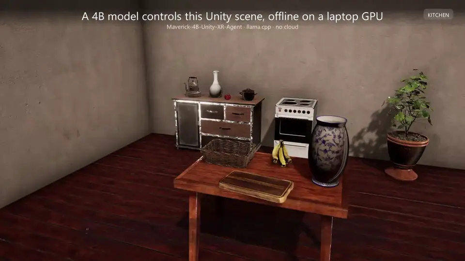

# Maverick XR Agent for Unity

Maverick lets people control objects in a Unity scene with English commands. A user can type “put the red mug on the counter,” ask where a tool is, or point at an object and say “highlight that.” The model reads a structured description of the scene and returns tool calls. The Unity package checks those calls and applies the supported actions.

The model runs locally through llama.cpp. Once the model and runtime have been downloaded, inference needs no internet connection, account, or API key. For spoken commands, connect a speech recognizer and pass its text to the same command interface.

Developed by **Eren Ata** at the **Extended Reality Laboratory (XRLab), Manisa Celal Bayar University**.

[Download Maverick 1.1](https://huggingface.co/ErenAta00/Maverick-4B-Unity-XR-Agent-1.1/resolve/05d9f77aef06c9bcb20c71622a3037a25f9a5e4f/Maverick-4B-Unity-XR-Agent-1.1.Q4_K_M.gguf?download=true) · [Maverick 1.1 model card](https://huggingface.co/ErenAta00/Maverick-4B-Unity-XR-Agent-1.1) · [Maverick 1.0 model card](https://huggingface.co/ErenAta00/Maverick-4B-Unity-XR-Agent) · [Article on 1.1](https://huggingface.co/blog/ErenAta00/maverick-1-1-undo-pointing-other-rooms) · [Article on 1.0](https://huggingface.co/blog/ErenAta00/maverick-4b-unity-xr-agent)

## What is new in 1.1

Version 1.1.0 adds support for [Maverick 1.1](https://huggingface.co/ErenAta00/Maverick-4B-Unity-XR-Agent-1.1). Besides everything Maverick 1.0 did, that model can undo its own commands, resolve “that one” from what people look and point at, and tell who is speaking when several people share a scene. These abilities are switched on with a new setting, `SceneAgent.schemaVersion`. The default, `V0`, behaves exactly as in 1.0, and both Maverick 1.0 and Maverick 1.1 work with it. In either format, Maverick 1.1 is also much better at acting on objects in other rooms and at declining requests it cannot meet.

The [schema 1.1 guide](Documentation~/schema-1-1.md) explains the new format and how to switch to it, and the [changelog](CHANGELOG.md) lists every change since 1.0.

## Demo

[](https://github.com/mcbu-xrlab/Maverick-Unity/releases/download/v1.0.0/maverick-demo.mp4)

## What is included

This repository contains the Unity Package Manager package, editor setup tools, a desktop chat interface, and the code that manages the local model server. The Maverick model weights are distributed separately on Hugging Face as GGUF files; the recommended Q4_K_M file is 2.50 GB. llama.cpp is also downloaded separately.

The package is intended for developers building scene interaction in simulations, training applications, showrooms, accessibility interfaces, and games. Its input is scene data supplied by Unity. It does not inspect camera images.

| Included in the package | Supplied by your application |
| --- | --- |
| Local model server startup and shutdown | Speech recognition, if you want voice input |
| Scene descriptions and a command loop for 11 tools (12 with `undo` in schema 1.1) | XR interface and controller bindings |
| Tool and object checks | Player rig movement when the room changes |
| Object selection after a clarification question | Door animations, button behavior, and other scene-specific effects |
| Editor setup, validation, and command reports | Synchronization with objects moved by other interaction systems |

## Requirements

- Unity **2022.3 LTS or later**. The package declares 2022.3 as its minimum version; individual later releases have not all been tested.
- **Windows x64** for the documented setup. Linux, macOS, and standalone XR headsets have not been validated.
- Approximately **3.1 GB of free GPU memory for the model server** at the tested settings, in addition to the memory your scene needs. CPU execution is available but slower.
- Disk space for the **2.50 GB model**, a compatible llama.cpp build, and your Unity project or game.
- Git installed for Unity's Git URL installation method.

Testing was carried out on Windows 11 with an RTX 3050 Ti laptop GPU. See [evaluation and hardware measurements](Documentation~/results.md) for the scope of those results.

## Install

### 1. Add the Unity package

In Unity, open **Window > Package Manager**, select **+ > Add package from git URL**, and enter:

```text
https://github.com/mcbu-xrlab/Maverick-Unity.git#v1.1.0
```

The tag selects a fixed release. Omit `#v1.1.0` if you deliberately want the current default branch.

### 2. Add the runtime and model

Choose **Tools > Scene Agent > Open Model Folder**. Unity creates `Assets/StreamingAssets/SceneAgent/`.

Download a Windows x64 build from the [llama.cpp releases](https://github.com/ggml-org/llama.cpp/releases). Choose a backend that matches your hardware, such as CUDA for a compatible NVIDIA GPU, Vulkan for a supported GPU, or CPU. Extract the complete runtime distribution into that folder, with `llama-server.exe` directly inside it. Include its required DLLs and any companion runtime archive listed for that build.

Download [Maverick-4B-Unity-XR-Agent-1.1.Q4_K_M.gguf](https://huggingface.co/ErenAta00/Maverick-4B-Unity-XR-Agent-1.1/resolve/05d9f77aef06c9bcb20c71622a3037a25f9a5e4f/Maverick-4B-Unity-XR-Agent-1.1.Q4_K_M.gguf?download=true) into the same folder:

```text
Assets/StreamingAssets/SceneAgent/
  llama-server.exe
  ...runtime DLLs and supporting files...
  Maverick-4B-Unity-XR-Agent-1.1.Q4_K_M.gguf
```

The weights are hosted on Hugging Face so installing or updating the Unity package does not download the model again. [Model details and checksums](Documentation~/model-download.md) cover Maverick 1.1 and Maverick 1.0, and also list the larger Q8_0 file.

### 3. Prepare a scene

1. Choose **Tools > Scene Agent > Set Up Scene**.
2. Give your objects descriptive English names, such as `Red Mug`, `Table`, or `Floor Lamp`.
3. Select the objects the agent may use and choose **Tools > Scene Agent > Make Selected Interactive**.
4. Review each generated `SceneItem`: its ID, label, color, room, and supporting object.
5. Choose **Tools > Scene Agent > Validate Scene** and resolve any errors.
6. Enter Play mode, wait for the model to load, and try a command that matches your scene.

For example, a scene with a mug and a table can accept `put the red mug on the table`. If several mugs fit the request, the chat interface offers a choice. Press **F1** to hide or show the desktop chat interface.

“Make Selected Interactive” reparents selected objects under the Scene Agent object. Review that change when your scene depends on an existing hierarchy. The editor operation supports Undo.

See the [installation guide](Documentation~/getting-started.md) for builds, CPU execution, and external server settings.

## How commands are handled

For each request, the package sends the system prompt, the user's text, and a JSON description of the current room to the model. That description includes object IDs, labels, optional colors and states, supporting objects, positions, and the player's hands and gaze target.

The model returns a tool call, a clarification question, or a text reply. The package checks tool calls against the available tools and known IDs. Unity then checks whether the requested action is allowed for the object. Each tool result is returned to the model so it can continue or explain the outcome. The default limit is four model turns per command, or six in schema 1.1.

| Tool | Behavior |
| --- | --- |
| `grab`, `release` | Assign an object to a hand or release a held object |
| `place` | Place a movable object on a surface or inside a container |
| `move_by`, `rotate` | Change an object's position or rotation |
| `set_state` | Change a supported state, such as on/off or open/closed |
| `press` | Record a button press for your application to handle |
| `highlight` | Mark objects for visual emphasis |
| `teleport` | Change the current room; your application moves the player rig |
| `find_objects` | Search object labels across rooms |
| `ask_clarification` | Ask the user to choose between candidate objects |
| `undo` | Reverse the agent's last one to three commands (schema 1.1 only) |

An object's label determines its default capabilities through the supplied catalog. For a custom object, enable `SceneItem.overrideAffordances` and set its capabilities explicitly.

Keep `fallbackDecoding` and `guardSubstitutes` enabled. The first rejects unsupported tools or enum values and retries malformed calls or unknown IDs with a scene-specific grammar. The second blocks certain substitutions where the requested object is in another room. These checks reduce errors; they do not prove that every accepted action matches the user's intent.

## Connect your own input

Attach this component to a GameObject and assign the scene's `SceneAgentSession`. Call `Submit` with typed text or the completed transcript from your speech recognizer:

```csharp
using SceneAgent;
using UnityEngine;

public sealed class MaverickCommandInput : MonoBehaviour
{
    [SerializeField] private SceneAgentSession session;

    public void Submit(string text)
    {
        if (session == null || session.Busy || string.IsNullOrWhiteSpace(text))
            return;

        StartCoroutine(session.Command(text));
    }

    public void ChooseObject(string itemId)
    {
        if (session == null || session.Busy || session.PendingRequest == null)
            return;

        if (session.Candidates.Contains(itemId))
            StartCoroutine(session.Answer(itemId));
    }
}
```

The public command methods do not queue requests. Check `session.Busy` in every input source. The [integration guide](Documentation~/unity-integration.md) covers events, room changes, gaze, object state, and scripted runs.

## Reported results

The published evaluation of Maverick 1.0 reports the following results, measured with its output-checking setup:

| Test | Result |
| --- | --- |
| 499 single-step instructions adapted from ALFRED | 83.8% correct first action and object |
| 60 ALFRED-derived items with held-out object types | 91.7% |
| 2,900 template-based capability commands | 96.4% |
| 440 capability commands executed in a Unity scene | 97.3% |
| Package installation and runtime checks | 54 of 55 passed |

The ALFRED-derived evaluation uses structured scene descriptions and three action types. Its scores are not directly comparable with the original ALFRED benchmark's full visual task completion scores. The Unity commands are a subset of the capability tests.

On the tested laptop, the model server used 3.06 GB of GPU memory. Median first-answer latency for the model alone was 1.18 seconds. Complete commands often require two model calls; their latency depends on rendering load, temperature, and the number of steps.

See [evaluation details](Documentation~/results.md) for baselines, test limitations, and the training configuration. The training and benchmark reproduction files are not included in this repository.

Maverick 1.1 was measured on test sets that were sealed before its training and run once. On its six new-ability sets it scores 93 to 100%, where Maverick 1.0 scores 33 to 87%. On the 2,900 capability commands it scores 97.3%, and on the 499 ALFRED-derived instructions 83.2%, level with Maverick 1.0 at 83.8%. In a Unity scene, 197 of 200 held-out development commands ran correctly, and the 22 scripted acceptance steps of this package version passed. Its weaknesses, including a tendency to act instead of asking in unfamiliar situations, are listed on the [Maverick 1.1 model card](https://huggingface.co/ErenAta00/Maverick-4B-Unity-XR-Agent-1.1).

## Current limits

- English commands and the 11 listed tools (12 with `undo` in schema 1.1). Object creation, deletion, resizing, and recoloring are outside the current tool set.
- Voice input requires a separate recognizer. The included chat interface is intended for desktop testing; provide your own XR interface.
- Start with fewer than about 60 interactive objects per room at the default 4,096-token context, leaving space for tool results and follow-up calls.
- Cross-room finding and fetching are supported, but commands such as “turn on the lamp” may be declined when the lamp is elsewhere. Name the room or move there first.
- Placement uses the target's center and catalog or configured surface height. Objects can overlap, and custom meshes may need placement adjustments.
- Placement orientation is recorded as metadata; the current visual synchronization does not apply that metadata as a rotation. Implement that behavior in your application if required.
- Objects moved by other systems need their `SceneItem` state updated; in schema 1.1, report such changes with `SceneWorld.ApplyExternalChange` or turn on `syncFromTransforms`. Camera direction does not change the world-axis directions used by `move_by`.
- The output check can still pass a valid call that is followed by a truncated one. See [known issues](Documentation~/troubleshooting.md#known-implementation-issues) before relying on it for custom integrations.

In XR, set `LocalModelServer.capFrameRate` to **0** and let the headset control presentation timing. The default 30 FPS cap was used for desktop testing with the renderer and model sharing one GPU.

## Documentation and feedback

- [Installation and deployment](Documentation~/getting-started.md)
- [Unity integration and component reference](Documentation~/unity-integration.md)
- [Schema 1.1: undo, attention and several people](Documentation~/schema-1-1.md)
- [Model download, checksum, and direct use](Documentation~/model-download.md)
- [Training and evaluation](Documentation~/results.md)
- [Troubleshooting and known issues](Documentation~/troubleshooting.md)
- [Changelog](CHANGELOG.md)

Report reproducible package problems in [GitHub Issues](https://github.com/mcbu-xrlab/Maverick-Unity/issues). Model questions can also be raised in the [Hugging Face Community tab](https://huggingface.co/ErenAta00/Maverick-4B-Unity-XR-Agent-1.1/discussions).

## License and credits

The Unity package is released under the [MIT License](LICENSE.md). The model is released separately under [Apache-2.0](https://huggingface.co/ErenAta00/Maverick-4B-Unity-XR-Agent-1.1/blob/main/LICENSE). llama.cpp is a separate dependency with its own [MIT License](https://github.com/ggml-org/llama.cpp/blob/master/LICENSE).

Maverick is fine-tuned from [Qwen3-4B](https://huggingface.co/Qwen/Qwen3-4B). Training used [Unsloth](https://github.com/unslothai/unsloth), and the human-written evaluation instructions were adapted from [ALFRED](https://askforalfred.com/). The [project article](https://huggingface.co/blog/ErenAta00/maverick-4b-unity-xr-agent) provides the research context and citation.
